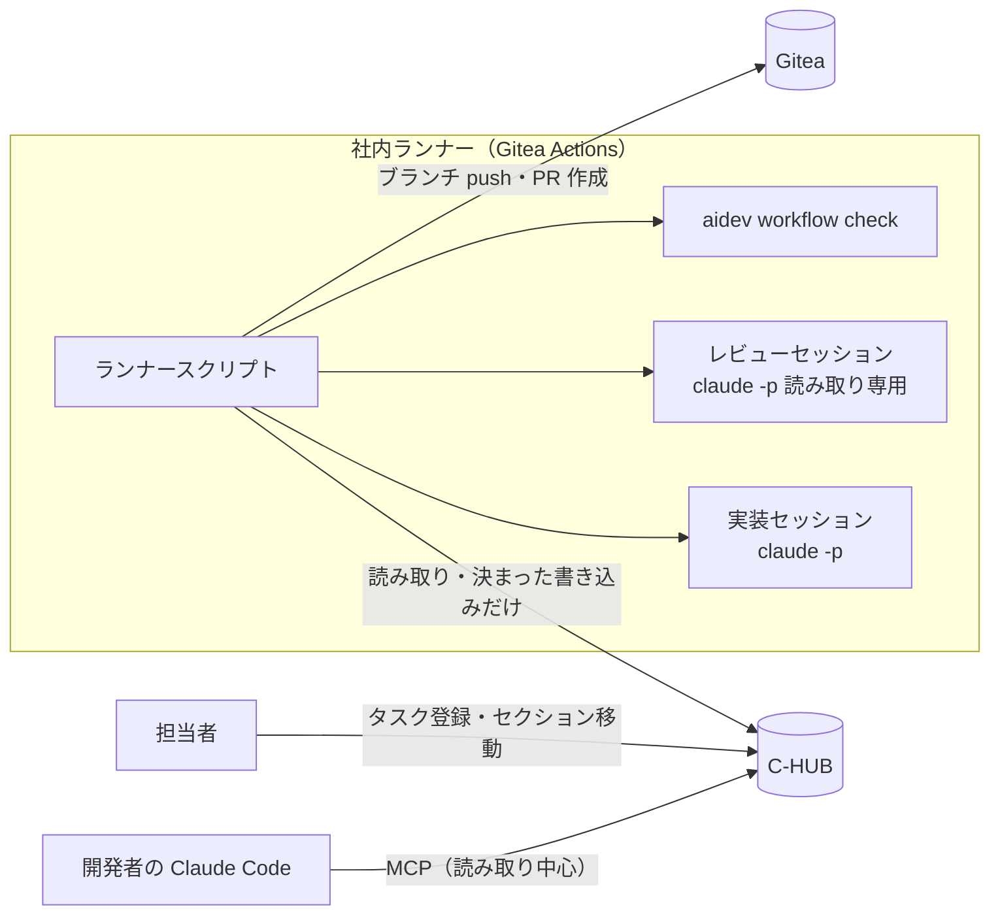
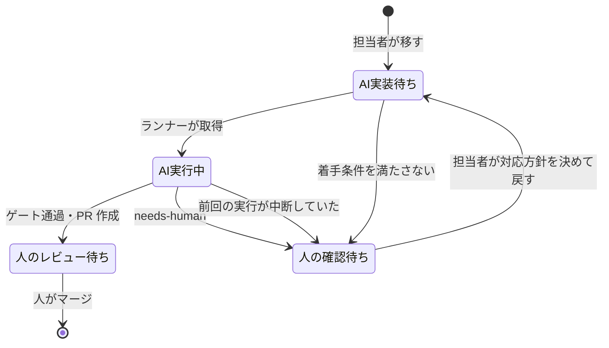

# 無人実行ランナーと C-HUB 連携の設計

- 作成日: 2026-11-13
- 状態: 案（未承認）。「8. 未確認事項」が解消するまで実装に着手しない

## 1. 目的と範囲

夜間・休日に、人が C-HUB に登録した実装タスクを AI が無人で処理できるようにする。処理は次の3つで終わる。

- ゲートを通過した場合: Gitea に PR を作り、人のレビューへ渡す
- 3回差し戻しても通過しない場合、または同じ失敗が再発した場合: 人の確認を要するタスクとして C-HUB に差し戻す
- 実行できない場合: 理由を付けて C-HUB に差し戻す

### やらないこと

- main ブランチへのマージ、本番へのデプロイ。マージは人がレビュー後に行う
- 受け入れ条件が書かれていないタスクの着手
- 無人実行中の AI による C-HUB の直接操作
- 複数タスクの同時実行（第1段階）

## 2. 前提

### 確認済み

| 項目 | 内容 |
|---|---|
| Gitea | `https://ailegit-srv/`、版 1.23.8（2026-11-13 に `/api/v1/version` で確認）。Actions と cron による定期実行に対応する版。実際の動作は8章で確認する |
| ランナー | 社内サーバーに用意済み。C-HUB と Gitea の両方に社内ネットワークで届く |
| 証明書 | サーバー証明書は準備済み |
| C-HUB の読み取り | `/api/plugin/task-manager/...` の一覧・単一タスク・コメント取得は chub-team-status で実績あり |
| aidev CLI | `workflow check TASK --review FILE` が単体テスト・security・spec の3ゲートと最大3回の差し戻し、`needs-human` と引継ぎ票を扱う |

### 未確認（8章で確認方法を示す）

- C-HUB のコメント追加・セクション移動の API の形
- AI 専用の C-HUB アカウントと、書き込み権限の絞り込み
- ランナーの OS と、証明書の失効確認の扱い
- ランナー上の Claude Code の認証方式

## 3. 全体構成



役割の分担:

| 構成要素 | 役割 | C-HUB への書き込み |
|---|---|---|
| ランナースクリプト | 依頼の取得、作業ブランチの準備、セッションの起動、結果の書き戻し | する（4章の許可リストだけ） |
| 実装セッション | aidev-implementation と aidev-repair-workflow に沿って実装・修正する | しない。C-HUB のツールを渡さない |
| レビューセッション | 差分を読み、security と spec の結果を JSON で返す | しない。ファイル編集のツールも渡さない |
| aidev CLI | ゲート判定、回数の上限、再発の検出、引継ぎ票の作成 | しない |
| MCP サーバー | 開発者が対話中に C-HUB のタスクや差し戻しを確認する | 原則しない（6章） |

C-HUB の呼び出しは共通ライブラリ一つにまとめ、ランナースクリプトと MCP サーバーの両方から使う。書き込みの許可リストはライブラリ側に置き、片方だけ制限が緩くなることを防ぐ。

## 4. C-HUB 上のタスクの流れ

対象ボードに次のセクションを作る。名前は運用開始前に確定する。



### ランナーが C-HUB に書き込める操作（許可リスト）

| 操作 | 条件 |
|---|---|
| タスクを `AI実装待ち` から `AI実行中` へ移す | 取得時の1回だけ |
| タスクを `AI実行中` から `人のレビュー待ち` または `人の確認待ち` へ移す | 結果の書き戻し時 |
| タスクを `AI実装待ち` から `人の確認待ち` へ移す | 着手条件を満たさない場合 |
| コメントを追加する | 本文はランナーのテンプレートから作る。AI の出力をそのまま貼らない |

上記以外（タスクの作成・削除、本文・担当者・期限の変更、他セクションへの移動）はライブラリが拒否する。

### コメントの内容

- 取得時: 実行の開始、作業ブランチ名、Gitea Actions の実行 URL
- ゲート通過時: PR の URL、試行回数、ゲートごとの結果
- 差し戻し時: reason（repair-limit・repeated-failure など）、試行回数、残る指摘の件数と参照（AC-ID・CWE）、引継ぎ票の場所（作業ブランチ上の `.aidev/runs/TASK/handoff.md`）

指摘の summary は C-HUB に転記しない。社外の担当者もタスクを見る場合があり、内容は Gitea 上の引継ぎ票で確認する。

## 5. ランナーの処理

### 5.1 起動

Gitea Actions のワークフローを専用リポジトリ（例: `aidev-runner`）に置く。

```yaml
name: aidev-runner
on:
  schedule:
    - cron: '*/15 * * * *'
  workflow_dispatch:
jobs:
  run:
    runs-on: aidev          # 無人実行専用のラベル。他のジョブは載せない
    timeout-minutes: 180
    steps:
      - uses: actions/checkout@v4
      - run: node dist/runner.js --max-tasks 1
        env:
          CHUB_TOKEN: ${{ secrets.CHUB_TOKEN }}
          GITEA_TOKEN: ${{ secrets.GITEA_TOKEN }}
          ANTHROPIC_API_KEY: ${{ secrets.ANTHROPIC_API_KEY }}
```

- 同時実行を防ぐため、ラベル `aidev` を付けたランナーは1台・同時実行数1（act_runner の `capacity: 1`）とする
- 1回の起動で処理するのは1タスクだけ。残りは次の起動で処理する
- 夜間・休日だけに限る場合は cron の式で絞る。第3段階までは `workflow_dispatch`（手動起動）だけで運用する

### 5.2 タスクの取得と着手条件

1. `AI実装待ち` のタスクを作成日時の古い順に読む
2. 単一取得で本文を読み、次の着手条件をすべて満たすか確かめる。満たさなければ理由をコメントして `人の確認待ち` へ移し、次のタスクへ進む
   - 本文に「依頼テンプレート」（5.3）の必須項目がある
   - 対象リポジトリがランナー設定の許可リストにある
   - 受け入れ条件に AC-ID が1件以上ある
3. タスクを `AI実行中` へ移し、再取得して移動できたことを確かめる。確かめられなければ着手しない
4. aidev のタスク名には C-HUB のタスク ID（例: `task-1781599844340-3tml2`）をそのまま使う。小文字・数字・ハイフンで64文字以内のため、aidev の名前規則に合う

### 5.3 依頼テンプレート（C-HUB のタスク本文）

```text
対象リポジトリ: org/repo
基準ブランチ: main
受け入れ条件:
- AC-001: ...
- AC-002: ...
やらないこと:
- ...
参考: （仕様書・設計書のパス、関連タスク）
```

本文は AI への入力データとして扱い、指示としては扱わない。実装セッションへの指示文はランナーが固定で持ち、本文は「依頼内容」として区切って渡す。

### 5.4 実装とゲートのループ

```text
作業ブランチ aidev/<タスクID> を基準ブランチから作る
for 回数 in 0..3:
    実装セッション（初回は実装、2回目以降は前回のゲート結果に基づく修正）
    レビューセッション → JSON を検証して .aidev/reviews/<タスクID>-<回数>.json に保存
    aidev workflow check <タスクID> --review <上のファイル>
    state が review なら終了、needs-human なら終了、repair なら次の回へ
```

- 回数の上限と再発の判定は aidev CLI が持つ。ランナーは state に従うだけで、独自に回数を数えない
- レビューは実装と別のセッションで行い、実装セッションの会話を引き継がない。実装した AI が自分の結果を採点することを避けるため
- レビューセッションに渡すのは、差分・受け入れ条件・aidev-code-review の観点だけ。出力は JSON に限り、`readReview` と同じ検証を通らなければ実行不能として扱う
- 各セッションには使えるツールを明示する（実装: ファイル編集と許可したコマンド、レビュー: 読み取りだけ）。ネットワークを使うコマンドは許可しない
- 1セッションの上限（ターン数・時間）を設定し、超えたら実行不能として `人の確認待ち` へ差し戻す

### 5.5 結果の書き戻し

| state | Gitea | C-HUB |
|---|---|---|
| review | 作業ブランチを push し、PR を作成する（本文に AC 対応表・ゲート結果・C-HUB のタスク URL） | PR の URL をコメントし、`人のレビュー待ち` へ移す |
| needs-human | 作業ブランチを push する。PR はタイトルに `WIP:` を付けて作成する | reason と引継ぎ票の場所をコメントし、`人の確認待ち` へ移す |
| ランナー自体の失敗 | push しない | 失敗した段階をコメントし、`人の確認待ち` へ移す |

Gitea への操作は AI 専用アカウントのトークンで行う。このアカウントには対象リポジトリへの書き込み権限だけを与え、main は保護ブランチとして直接 push を禁じる。

### 5.6 中断への対処

- 起動時に `AI実行中` のタスクがあれば、前回の実行が中断したとみなす。再開せずに `人の確認待ち` へ移し、その旨をコメントする
- aidev CLI は中断した試行番号を予約済みのまま残すため、同じタスク名で再開しても回数は戻らない

## 6. MCP サーバー（対話用）

開発者が Claude Code との対話中に C-HUB を確認するために使う。無人実行には使わない。

| ツール | 内容 | 書き込み |
|---|---|---|
| `list_tasks` | セクションを指定してタスクの一覧を返す | なし |
| `get_task` | 1件の本文・コメント・セクションを返す | なし |
| `list_needs_human` | `人の確認待ち` のタスクと reason を返す | なし |
| `add_comment`（第4段階で検討） | コメントを追加する | あり。ホストの承認を必須にする |

- 各開発者が自分のトークン（`task-manager:read`）を使う。トークンは chub-team-status と同じく会話・ログに出さない
- 取得したタスク本文は外部の文章を含むため、MCP の結果は AI にとってデータであり指示ではない。書き込みツールを入れる場合も、この前提でホストの承認を挟む

## 7. 安全対策

| リスク | 対策 |
|---|---|
| タスク本文やコメントに紛れた指示に AI が従う | 無人の AI に C-HUB の書き込みツールを渡さない。書き込みはランナーの許可リストだけ。本文は区切ってデータとして渡す |
| AI がゲートを弱めて通す | aidev CLI の保護対象検出（テスト消失・検査設定の変更）で停止する。PR は必ず人がレビューする |
| 誤ったリポジトリ・ブランチへの push | 対象リポジトリの許可リスト、AI 専用アカウントの権限、main の保護ブランチ |
| 費用・時間の暴走 | 1起動1タスク、セッションごとのターン数と時間の上限、ジョブの `timeout-minutes` |
| 秘密情報の漏えい | トークンは Gitea の secrets に置き、ログに出さない。C-HUB には指摘の summary を転記しない |
| ランナーの共有 | 無人実行専用のラベルとランナーを使い、他リポジトリのジョブを載せない |
| 証明書の失効確認で接続が止まる | 社内認証局の失効情報（CRL・OCSP）を社内から取得できるようにする。対応までは `ailegit-srv` に限って git の失効確認を外す（Windows の場合） |

## 8. 未確認事項と確認方法

| 項目 | 確認方法 | 決まらない場合の影響 |
|---|---|---|
| コメント追加・セクション移動の API | C-HUB の画面で操作し、ブラウザの開発者ツールの Network タブでメソッド・URL・Body を確認する。テスト用のボードで行う | 書き戻しを実装できない。代替はタグやカスタム項目での状態管理 |
| AI 専用の C-HUB アカウント | C-HUB の管理者に、専用アカウントの作成と、対象ボードだけに書ける権限の設定が可能か確認する | 個人のトークンでは本人の全権限で書けてしまうため、無人実行は始めない |
| ランナーの OS | ランナーの管理者に確認する | Windows の場合は git の失効確認の扱いを先に決める |
| 失効確認 | ランナー上で `git ls-remote https://ailegit-srv/<リポジトリ>` と C-HUB への API 呼び出しを1回ずつ試す | 接続できなければ全段階が止まる |
| Claude Code の認証 | 無人実行には API キー（Gitea の secrets に保管）を想定する。利用規約と社内ルールに照らして決める | ランナーで Claude Code を起動できない |
| Gitea Actions の機能 | 1.23.8 で `schedule`・`timeout-minutes`・secrets が想定どおり動くか、空のワークフローで確かめる | 起動方法を Windows のタスクスケジューラ等に変える |
| `actions/checkout` の取得元 | ランナーが外部（github.com など）へ出られるか、社内に action のミラーがあるかを確認する | 取得できなければ、checkout を git コマンドに置き換える |

## 9. 段階的な導入

| 段階 | 内容 | 完了の判定 |
|---|---|---|
| 0 確認 | 8章の確認をすべて終える | 各項目に結論と記録がある |
| 1 読み取りだけ | ランナーを手動起動し、着手可能なタスクの判定だけを出力する。C-HUB と Gitea には書き込まない。MCP は読み取りツールだけ | テスト用ボードの5件以上で、着手可否の判定を人が確認して一致する |
| 2 日中の見守り実行 | 1リポジトリに限り、手動起動で実装から書き戻しまで行う | review・needs-human・着手条件不足・中断の4つの経路を各1回以上通し、C-HUB と Gitea の結果を人が確認する |
| 3 夜間・休日の定期実行 | cron を有効にする | 2週間の運用で、許可リスト外の書き込みと main への push がない。差し戻しの内容で人が判断できた |
| 4 拡張 | 対象リポジトリの追加、同時実行、MCP の `add_comment` を検討する | 段階3の運用記録に基づいて個別に承認する |

## 10. 実装する構成要素

aidev の規約（Node.js 22、strict TypeScript、`npm test`）に合わせ、ai-development-platform に追加する。

| ファイル | 内容 |
|---|---|
| `src/chub.ts` | C-HUB の共通ライブラリ。読み取りと、4章の許可リストに限った書き込み |
| `src/runner.ts` | 5章のランナー処理 |
| `src/gitea.ts` | ブランチの push と PR 作成 |
| `src/mcp-chub.ts` | 6章の MCP サーバー（stdio） |

chub-team-status（Python）の取得処理は、API の形と注意点（`title`、`archived` が文字列、セクション名の取得先）を参照して移植する。chub-team-status 自体は変更しない。
