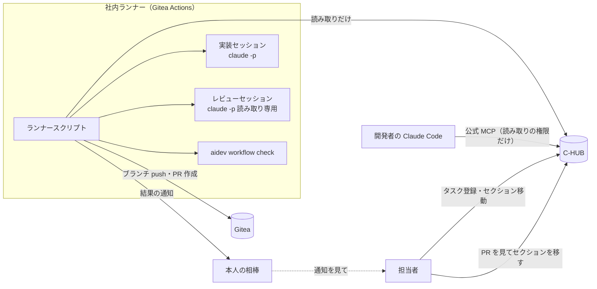
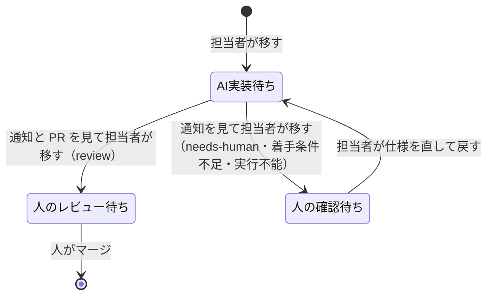

# 無人実行ランナーと C-HUB 連携の設計

- 作成日: 2026-11-13
- 状態: 案（未承認）。書き込みを伴う段階2以降は「8. 未確認事項」が解消するまで実装に着手しない。読み取りだけの段階1は実装済み（9章）
- 2026-11-26 改訂: C-HUB への書き込みをやめた（案B）。ランナーは C-HUB を読むだけで、結果は Gitea の PR に置き、本人の相棒に通知する。セクションの移動は人が行う。経緯は「1.1 C-HUB に書き込まない理由」

## 1. 目的と範囲

夜間・休日に、人が C-HUB に登録した実装タスクを AI が無人で処理できるようにする。処理は次の3つで終わり、いずれも相棒に通知する。

- ゲートを通過した場合: Gitea に PR を作り、人のレビューへ渡す
- 3回差し戻しても通過しない場合、または同じ失敗が再発した場合: 引継ぎ票を付けた `WIP:` の PR を作り、人の確認を求める
- 実行できない場合: 理由を通知する

C-HUB のセクションは、通知と PR を見た人が移す。

### やらないこと

- main ブランチへのマージ、本番へのデプロイ。マージは人がレビュー後に行う
- 受け入れ条件が書かれていないタスクの着手
- ランナーと AI による C-HUB のタスクへの書き込み（セクションの移動・コメントを含む）
- 複数タスクの同時実行（第1段階）

### 1.1 C-HUB に書き込まない理由（2026-11-26 決定）

当初はランナーがセクションを移し、コメントを書く設計だった。その前提は「書き込みを対象ボードに絞ったキー」で、そのためには C-HUB に専用アカウントを追加する必要があった。アカウントを追加しない場合の案を比べ、次の案Bを採った。

| 案 | 内容 | 採否 |
|---|---|---|
| A | 本人のキーを読み取り専用で使い、結果は Gitea の PR に置く。カードは人が移す | B に含む |
| B | A に加え、本人の相棒に結果を通知する | 採用 |
| C | ランナーは結果を残すだけにし、朝に人が公式 MCP で対話して一括で書き戻す | 不採用（書き戻しが人の作業として残る点は B と同じで、手順が増える） |
| D | 本人のキーに書き込みも付け、「AI に渡さない」とランナーの許可リストで守る | 不採用（キーが漏れると本人が見えるすべてのボードに書ける） |

案Bでは、ボードを壊さないことをキーの権限そのもので保証できる（ランナーのコードの正しさに頼らない）。カードの移動を手で行う負担が大きいと分かったら、専用アカウントによる書き戻し（旧設計）を改めて検討する。

## 2. 前提

### 確認済み

| 項目 | 内容 |
|---|---|
| Gitea | `https://ailegit-srv/`、版 1.23.8（2026-11-13 に `/api/v1/version` で確認）。Actions と cron による定期実行に対応する版。実際の動作は8章で確認する |
| ランナー | 社内サーバーに用意済み |
| 証明書 | Gitea のサーバー証明書は準備済み |
| C-HUB の接続先 | `https://chub.ailesys.co.jp`（2026-11-16 に確認）。公開の証明書で、curl は失効確認を省かずに接続できた。以前の社内ホスト `wkozu2024:3030` は使わない |
| C-HUB の API | 公開の API 定義 `/openapi.json`・説明 `/llms.txt`・`/api-guide.html` がある。セクションはプロジェクトの詳細（`GET /api/plugin/task-manager/projects/{projectId}` の `data.sections`）で取る。セクションの移動は `PUT /api/plugin/task-manager/tasks/{taskId}` に `section_id` を送る（`task-manager:write`） |
| C-HUB の公式 MCP | `https://chub.ailesys.co.jp/api/mcp`。OAuth 2.1 または API キーで接続する。書き込み系の道具は、権限があれば確認なしで実行される（削除など取り消せない操作だけ承認待ちになる） |
| API キーの発行 | 本人が「プラグイン > AI とつなぐ」から用途と権限を選んで申請し、管理者かオーナーが承認する。本人がパスワードを入れて1回だけ受け取る。権限は全46種類から個別に付け、有効期限があり、画面からすぐ失効できる（2026-11-26 に `/llms.txt` と API 利用ガイドで確認。実際の申請は未実施）。オーナーが作る「AI 用のアカウントのキー」はパスワード管理（vault）用で、この設計では使わない |
| キーの届く範囲 | キーは発行した本人が見える範囲を超えない。「AI に渡さない」にしたプロジェクトとその中身は、API キーと OAuth からは無いものとして扱われる |
| 相棒への通知 | `sugar-forum:digest` で本人の相棒の会話にまとめを入れられる（`POST /api/plugin/sugar-forum/digest`、1日5通まで、API キーだけ）。届くのは本人の相棒だけ。相棒からの頼みを受ける `sugar-forum:pc-inbox` もある |
| aidev CLI | `workflow check TASK --review FILE` が単体テスト・security・spec の3ゲートと最大3回の差し戻し、`needs-human` と引継ぎ票を扱う |

### 未確認（8章で確認方法を示す）

- 相棒への通知（`sugar-forum:digest`）の送る形式（公開の API 定義に載っていない）
- 読み取りと通知の権限を付けたキーの申請が承認されるか
- ランナーの OS と、Gitea への接続での証明書の失効確認の扱い
- ランナーから `chub.ailesys.co.jp` へ届くか
- ランナー上の Claude Code の認証方式

## 3. 全体構成



役割の分担:

| 構成要素 | 役割 | C-HUB への書き込み |
|---|---|---|
| ランナースクリプト | 依頼の取得、作業ブランチの準備、セッションの起動、PR の作成、相棒への通知 | しない。キーに書き込みの権限が無い |
| 担当者 | タスクの登録、通知と PR を見てのセクションの移動 | する |
| 実装セッション | aidev-implementation と aidev-repair-workflow に沿って実装・修正する | しない。C-HUB のツールを渡さない |
| レビューセッション | 差分を読み、security と spec の結果を JSON で返す | しない。ファイル編集のツールも渡さない |
| aidev CLI | ゲート判定、回数の上限、再発の検出、引継ぎ票の作成 | しない |
| C-HUB 公式 MCP | 開発者が対話中に C-HUB のタスクや差し戻しを確認する | しない。`task-manager:read` だけを許可する（6章） |

ランナーの C-HUB 呼び出しは共通ライブラリ（`src/chub.ts`）にまとめる。タスクへの書き込みの関数は作らず、ライブラリの通信処理は GET と通知の POST（`/api/plugin/sugar-forum/digest` だけ）以外を拒否する。キーにも `task-manager:write` を付けないため、ライブラリに誤りがあってもタスクは変わらない。対話用には自作せず、C-HUB 公式の MCP を使う（2026-11-16 決定）。

## 4. C-HUB 上のタスクの流れ

対象ボードに次のセクションを作る。名前は運用開始前に確定する。セクションを移すのはすべて人。



- 旧設計の `AI実行中` は置かない。ランナーが実行中かどうかは Gitea Actions の実行一覧で分かる
- ランナーが一度処理したタスクは、セクションが `AI実装待ち` のままでも再実行しない（5.2）。担当者が通知を見てカードを移すまでの間に、同じタスクを何度も実行しないため

### 相棒への通知の内容

本文はランナーのテンプレートから作り、AI の出力をそのまま入れない。1日5通の上限があるため、その日の4通目までは結果ごとに送る。5通目は「以降の結果は翌日にまとめて知らせる」旨とその時点の結果に使い、それ以降の結果はランナーの手元にためて翌日の最初の通知にまとめる。送った日時と件数はランナーの手元に記録する。

| 結果 | 通知する内容 |
|---|---|
| review | タスクのタイトルと ID、PR の URL、試行回数、ゲートごとの結果 |
| needs-human | タスクのタイトルと ID、reason（repair-limit・repeated-failure など）、試行回数、残る指摘の件数、`WIP:` の PR の URL（引継ぎ票はその PR の `.aidev/runs/TASK/handoff.md`） |
| 着手条件不足 | タスクのタイトルと ID、足りない項目 |
| 実行不能・中断 | タスクのタイトルと ID、止まった段階、Gitea Actions の実行 URL |

指摘の summary と notes は通知に入れず、PR と引継ぎ票で確認する。通知は本人にしか届かないが、相棒の会話が音声モードなどで読み上げられる場合を考え、短く保つ。通知が届かなくても、結果は Gitea の PR に必ず残る。

## 5. ランナーの処理

### 5.1 起動

Gitea Actions のワークフローを専用リポジトリ（例: `aidev-runner`）に置く。

```yaml
name: aidev-runner
on:
  schedule:
    - cron: '*/15 * * * *'
  workflow_dispatch:
jobs:
  run:
    runs-on: aidev          # 無人実行専用のラベル。他のジョブは載せない
    timeout-minutes: 180
    steps:
      - uses: actions/checkout@v4
      - run: node dist/runner.js --max-tasks 1
        env:
          CHUB_TOKEN: ${{ secrets.CHUB_TOKEN }}   # task-manager:read と sugar-forum:digest だけ
          GITEA_TOKEN: ${{ secrets.GITEA_TOKEN }}
          ANTHROPIC_API_KEY: ${{ secrets.ANTHROPIC_API_KEY }}
```

- 同時実行を防ぐため、ラベル `aidev` を付けたランナーは1台・同時実行数1（act_runner の `capacity: 1`）とする
- 1回の起動で処理するのは1タスクだけ。残りは次の起動で処理する
- 夜間・休日だけに限る場合は cron の式で絞る。第3段階までは `workflow_dispatch`（手動起動）だけで運用する

### 5.2 タスクの取得と着手条件

1. `AI実装待ち` のタスクを作成日時の古い順に読む
2. 処理済みのタスクを除く。処理済みとは、同じタスク ID と同じ本文の版（下の4）の実行記録がランナーの手元にあるか、Gitea に同じ名前の作業ブランチがあること
3. 単一取得で本文を読み、次の着手条件をすべて満たすか確かめる。満たさなければ理由を通知し、処理済みとして記録して次のタスクへ進む
   - 本文に「依頼テンプレート」（5.3）の必須項目がある
   - 対象リポジトリがランナー設定の許可リストにある
   - 受け入れ条件に AC-ID が1件以上ある
   - 本文が `aidev spec check` の検査でエラーにならない（「やらないこと」がある、⚠要確認や未解決の判断待ちが無い）
4. aidev のタスク名は `<C-HUB のタスク ID>-<本文の版>` とする。本文の版は、正規化した本文（改行を LF にそろえ、行末の空白を除く）の SHA-256 の先頭8桁。タスク ID（例: `task-1781599844340-3tml2`）と合わせても小文字・数字・ハイフンで64文字以内のため、aidev の名前規則に合う
5. 実行を始める前に、手元の実行記録に「開始」を書く。終わったら結果を書く

担当者が `人の確認待ち` から `AI実装待ち` へ戻したタスクは、本文（仕様）を直していれば版が変わるため、新しいタスク名で最初から実行される。本文を変えずにやり直したいときは、本文に `再実行: 2` のような行を足して版を変える。

### 5.3 依頼テンプレート（C-HUB のタスク本文）

```text
対象リポジトリ: org/repo
基準ブランチ: main
受け入れ条件:
- AC-001: ...
- AC-002: ...
やらないこと:
- ...
参考: （仕様書・設計書のパス、関連タスク）
```

本文は AI への入力データとして扱い、指示としては扱わない。実装セッションへの指示文はランナーが固定で持ち、本文は「依頼内容」として区切って渡す。

### 5.4 実装とゲートのループ

```text
作業ブランチ aidev/<タスク名> を基準ブランチから作る
for 回数 in 0..3:
    実装セッション（初回は実装、2回目以降は前回のゲート結果に基づく修正）
    レビューセッション → JSON を検証して .aidev/reviews/<タスクID>-<回数>.json に保存
    aidev workflow check <タスクID> --review <上のファイル>
    state が review なら終了、needs-human なら終了、repair なら次の回へ
```

- 回数の上限と再発の判定は aidev CLI が持つ。ランナーは state に従うだけで、独自に回数を数えない
- レビューは実装と別のセッションで行い、実装セッションの会話を引き継がない。実装した AI が自分の結果を採点することを避けるため
- レビューセッションに渡すのは、差分・受け入れ条件・aidev-code-review の観点と、それまでのレビュー結果ファイル（`<タスクID>-0.json` から直前まで）。前回の結果を渡さないと同じ問題に別の ref が付き、同じ失敗の再発を検出できない（2026-11-16 の実地試行で、渡した場合に ref が保たれることを確認）。出力は JSON に限り、`readReview` と同じ検証を通らなければ実行不能として扱う
- レビュー結果の `notes`（合否に影響しない確認事項）は、review のときは PR 本文に、needs-human のときは引継ぎ票に載せる。相棒への通知には入れない（指摘の summary と同じ扱い）
- 各セッションには使えるツールを明示する（実装: ファイル編集と許可したコマンド、レビュー: 読み取りだけ）。ネットワークを使うコマンドは許可しない
- 1セッションの上限（費用・時間）を設定し、超えたら実行不能として通知する

### 5.5 結果の受け渡し

| state | Gitea | 相棒への通知（4章） | 担当者が移す先 |
|---|---|---|---|
| review | 作業ブランチを push し、PR を作成する（本文に AC 対応表・ゲート結果・notes・C-HUB のタスク URL） | PR の URL と結果 | `人のレビュー待ち` |
| needs-human | 作業ブランチを push する。PR はタイトルに `WIP:` を付けて作成する（本文に引継ぎ票の内容） | reason と `WIP:` の PR の URL | `人の確認待ち` |
| 着手条件不足 | 何もしない | 足りない項目 | `人の確認待ち` |
| ランナー自体の失敗 | push しない | 止まった段階と Gitea Actions の実行 URL | `人の確認待ち` |

C-HUB のタスクの URL は PR の本文に載せ、PR から C-HUB へたどれるようにする。C-HUB 側からは PR へのリンクが無いため、担当者がカードを移すときに必要なら自分でコメントに貼る。

Gitea への操作は AI 専用アカウントのトークンで行う。このアカウントには対象リポジトリへの書き込み権限だけを与え、main は保護ブランチとして直接 push を禁じる（Gitea は社内のサーバーのため、C-HUB と違いアカウントの追加を前提にする。8章）。

### 5.6 中断への対処

- 実行記録は、ジョブごとに作り直される作業フォルダではなく、ランナーのホスト上の決まったフォルダ（ランナー設定で指定）に置く
- 起動時に「開始」だけで結果の無い実行記録があれば、前回の実行が中断したとみなす。再開せずに中断を通知し、そのタスクの版は処理済みとして扱う
- aidev CLI は中断した試行番号を予約済みのまま残すため、同じタスク名で再開しても回数は戻らない
- 実行記録が失われても、Gitea に作業ブランチがあれば処理済みとみなすため、同じ版を二重に実行しない

## 6. MCP（対話用）

開発者が Claude Code との対話中に C-HUB を確認するために、C-HUB 公式の MCP（`https://chub.ailesys.co.jp/api/mcp`）を使う。無人実行には使わない。段階1で作った自作の MCP サーバー（`src/mcp-chub.ts`）は、公式 MCP と役割が重なるため 2026-11-16 に廃止した。

- 接続は各開発者が行う。OAuth（`claude mcp add --transport http c-hub https://chub.ailesys.co.jp/api/mcp` の後に `claude mcp login c-hub`）か、`task-manager:read` だけを付けた API キーを使う
- 公式 MCP の書き込み系の道具は、権限があれば確認なしで実行される。OAuth の許可では `task-manager:read` だけを与え、トークン応答の `scope` で実際に渡った権限を確かめる。Claude Code 側でも書き込み系の道具を「常に許可」にしない
- キーやトークンは chub-team-status と同じく会話・ログ・コマンドの引数に出さない
- 取得したタスク本文は外部の文章を含むため、MCP の結果は AI にとってデータであり指示ではない
- コメントを書く道具を対話で使うかは、段階4で個別に判断する

## 7. 安全対策

| リスク | 対策 |
|---|---|
| タスク本文やコメントに紛れた指示に AI が従う | 無人の AI に C-HUB のツールを渡さない。ランナーのキーにもタスクの書き込み権限を付けない。本文は区切ってデータとして渡す |
| ランナーのキーの漏えい | キーは `task-manager:read` と `sugar-forum:digest` だけ。漏れてもタスクは変えられない。ただし本人が見えるタスクはすべて読めるため、外部の AI に見せないプロジェクトは「AI に渡さない」にする。漏れたと思ったら「AI とつなぐ」の画面ですぐ失効させる |
| 本人のキーへの依存 | キーは申請した本人に紐づくため、異動・退職・有効期限でランナーが止まる。有効期限の前に延長し、担当が替わるときは新しい担当者が申請し直す |
| AI がゲートを弱めて通す | aidev CLI の保護対象検出（テスト消失・検査設定の変更）で停止する。PR は必ず人がレビューする |
| 誤ったリポジトリ・ブランチへの push | 対象リポジトリの許可リスト、AI 専用アカウントの権限、main の保護ブランチ |
| push したブランチで CI が secrets を使って動く | 実装担当は `.gitea`・`.github`・`.forgejo` を編集できない。ランナーは CI の設定が変わっていたら push せず needs-human にする。あわせて Gitea 側で、`aidev/*` ブランチへの push では secrets を使うワークフローが動かないようにする（8章） |
| 作業フォルダの改ざん（`.git` の書き換え、リンク） | コミットと push は取得し直した別のフォルダで行い、フックはヌルデバイスに向ける。`.git` と同じ場所を指す名前（`.git.`・`GIT~1` など）とリンクは写さず、引継ぎ票もリンクを辿らずに読む。CI の設定の比較は、写し終えた中身（コミットする内容）で行う |
| 同じユーザーで動くプロジェクトのコード | ゲートの npm scripts と AI が書いたコードは、ランナーと同じ OS ユーザーで動く。ランナーの git はユーザーとシステムの git 設定を読まないが、ホームフォルダやランナー自身のファイルの書き換えまでは防げない。無人で回す前に、実装とゲートを別のユーザーか使い捨ての VM で動かし、外への通信を絞ることを検討する（残るリスク） |
| 費用・時間の暴走 | 1起動1タスク、セッションごとのターン数と時間の上限、ジョブの `timeout-minutes` |
| 秘密情報の漏えい | トークンは Gitea の secrets に置き、ログに出さない。相棒への通知には指摘の summary を入れない |
| ランナーの共有 | 無人実行専用のラベルとランナーを使い、他リポジトリのジョブを載せない |
| 証明書の失効確認で接続が止まる | Gitea（`ailegit-srv`）が対象。社内認証局の失効情報（CRL・OCSP）を社内から取得できるようにする。対応までは `ailegit-srv` に限って git の失効確認を外す（Windows の場合）。C-HUB（`chub.ailesys.co.jp`）は公開の証明書のため対象外の見込み |
| 対話用 MCP からの意図しない書き込み | 公式 MCP には `task-manager:read` だけを許可する。書き込みの権限が付いたキー・トークンを対話に使わない |

## 8. 未確認事項と確認方法

| 項目 | 確認方法 | 決まらない場合の影響 |
|---|---|---|
| キーの申請 | 本人が「AI とつなぐ」から `task-manager:read` と `sugar-forum:digest` だけを付けたキーを申請し、管理者かオーナーに承認してもらう。申請画面で、ほかの権限が付いていないことと有効期限を確かめる | キーが無ければ C-HUB を読めず、全段階が止まる |
| 相棒への通知の形式 | `POST /api/plugin/sugar-forum/digest` の送る形式は公開の API 定義に載っていない。実装は隣の窓口（digest/work-status）と同じ `{ content }`（4000字まで）と仮定した。API 利用ガイドの記載か C-HUB の管理者に確かめ、テストとして自分の相棒に1通送る | 通知ができなければ、結果は Gitea の PR と通知（Gitea のメール等）だけで知る |
| 見せないプロジェクト | 本人が見えるプロジェクトのうち、外部の AI に見せたくないものを洗い出し、「AI に渡さない」にする | 読み取りキーでもそれらのタスクを読めてしまう |
| Gitea の AI 専用アカウント | Gitea の管理者に、対象リポジトリへの書き込みだけを持つアカウントとトークンを作ってもらう。main を保護ブランチにする | PR を作れない。本人のトークンは使わない |
| `aidev/*` ブランチでの Actions | 対象リポジトリのワークフローが `aidev/*` への push や PR で secrets を使って動かないか、Gitea の管理者と確かめる | AI の変更が CI 経由で secrets に触れる余地が残る（ランナーは CI の設定の変更を push しないが、既存のワークフローがテストなどのプロジェクトのコードを secrets 付きで動かす場合は防げない） |
| ランナーの OS | ランナーの管理者に確認する | Windows の場合は git の失効確認の扱いを先に決める |
| 接続確認 | ランナー上で `git ls-remote https://ailegit-srv/<リポジトリ>` と、`https://chub.ailesys.co.jp/api/plugin/task-manager/projects` への API 呼び出しを1回ずつ試す | 接続できなければ全段階が止まる |
| Claude Code の認証 | 無人実行には API キー（Gitea の secrets に保管）を想定する。利用規約と社内ルールに照らして決める | ランナーで Claude Code を起動できない |
| Gitea Actions の機能 | 1.23.8 で `schedule`・`timeout-minutes`・secrets が想定どおり動くか、空のワークフローで確かめる | 起動方法を Windows のタスクスケジューラ等に変える |
| `actions/checkout` の取得元 | ランナーが外部（github.com など）へ出られるか、社内に action のミラーがあるかを確認する | 取得できなければ、checkout を git コマンドに置き換える |

## 9. 段階的な導入

| 段階 | 内容 | 完了の判定 |
|---|---|---|
| 0 確認 | 8章の確認をすべて終える | 各項目に結論と記録がある |
| 1 読み取りだけ | ランナーを手動起動し、着手可能なタスクの判定だけを出力する。C-HUB と Gitea には書き込まない。対話には公式 MCP を読み取りの権限だけで使う | テスト用ボードの5件以上で、着手可否の判定を人が確認して一致する（2026-11-16 に省略を決定。段階1の実装状況を参照） |
| 2 日中の見守り実行 | 1リポジトリに限り、手動起動で実装から PR の作成と通知まで行う。段階1で省いた実接続の確認として、最初に `--dry-run` を1回実行する | review・needs-human・着手条件不足・中断の4つの経路を各1回以上通し、Gitea の PR と相棒の通知を人が確認する。処理済みのタスクを再実行しないことも確かめる |
| 3 夜間・休日の定期実行 | cron を有効にする | 2週間の運用で、main への push がない。通知と PR の内容で人が判断し、カードを移せた。カードの移動の手間が許容できるかを記録する |
| 4 拡張 | 対象リポジトリの追加、同時実行、相棒からの頼みで実行する（`sugar-forum:pc-inbox`）、専用アカウントによる C-HUB への書き戻しを検討する | 段階3の運用記録に基づいて個別に承認する |

### 段階1の実装状況（2026-11-13）

- 実装済み: `src/chub.ts`（読み取りだけ。プロジェクト一覧・セクション一覧・プロジェクトのタスク一覧・単一タスク）、`src/runner.ts`（`--dry-run` だけ）。使い方は README の「C-HUB の読み取りと無人実行ランナー（段階1）」
- 2026-11-16 の変更: 接続先を `chub.ailesys.co.jp` に変更。セクションの取得を公開の API 定義どおりプロジェクトの詳細からに改め、ボードをプロジェクト ID（`tp-...`）でも指定できるようにした。自作の MCP サーバー（`src/mcp-chub.ts`）を廃止し、対話には公式 MCP を使う
- 書き込みの防止: 共通ライブラリの要求型は GET だけで、既定の通信処理も GET 以外を拒否する。書き込みの関数はまだ作っていない。リダイレクトは追わない（トークンを転送先へ送らない）。応答は 20 MiB までしか読まない（2026-11-17 追加）
- 秘密情報: トークンと接続先は環境変数または設定ファイルから読み、ランナーの出力から取り除く。エラー文には HTTP の状態とエラーコードだけを出す
- 着手条件の解釈（承認待ち）: 5.3 の必須項目は「対象リポジトリ」「基準ブランチ」「受け入れ条件」の3つとし、「やらないこと」「参考」は任意とした。AC-ID は「受け入れ条件:」の下の `- AC-数字: 説明` の行だけを数える。タスク ID が aidev のタスク名の規則（5.2 の4）に合わない場合も着手しない
- 5.6 の中断は、dry-run では `interrupted` として表示するだけ。2026-11-26 の改訂（案B）で `AI実行中` のセクションを廃止したため、段階2では「AI実行中に残るタスク」ではなく手元の実行記録から中断を判定するように改める。処理済みの除外（5.2 の2）と本文の版を含むタスク名（5.2 の4）も段階2で実装する
- 省いた確認（2026-11-16 決定）: API キーを使うテストは行わない。`chub.ailesys.co.jp` への実接続と、テスト用ボード `tp-1794804787123-7gx3d` での判定の照合（段階1の完了の判定）は実施していない。テストは差し替えた通信処理だけで行い、実サーバーを呼んでいない
- 省いたことの影響: 実際の応答の形（`data.sections` の位置、`archived`・`section_id` の型）、このPC・ランナーからの到達性、依頼テンプレートの読み取りが実データで正しいかは、段階2で初めて分かる。段階2の最初に、書き込みを伴わない `--dry-run` を1回実行して確かめてから PR の作成と通知に進む

### 5.4 のループの実装状況（2026-11-17）

C-HUB・Gitea に接続しない部分を先に実装した。使い方は README の「実装ループを自動で回す」。

- `aidev workflow run TASK --spec FILE`（`src/loop.ts`）: 実装担当とレビュー担当を別々の `claude -p` セッションで起動し、`workflow check` と同じ判定で review か needs-human まで回す。レビュー担当には前回までのレビュー結果と実装担当の報告を渡し、出力は JSON スキーマで強制する
- ゲート: 単体テスト（アプリの検査）・security・spec の3つ。差し戻しは人の確認なしで最大3回、同じ失敗の再発はその時点で止める。止まると needs-human と引継ぎ票（`.aidev/runs/TASK/handoff.md`）。合否に影響しない確認事項は notes に載る
- 権限: 実行できるのは決まった検査5つと読み取り用の git コマンド4つだけ（Bash と PowerShell の両方で完全一致）。実装担当は package.json・npm と git の設定・検査設定・`.aidev/`・Skill などを編集できない。MCP は読み込まない
- 環境変数: セッションは Claude Code 自身の認証情報だけを残し、ゲートの npm scripts は認証情報をすべて外した環境で動かす。作業ツリーの比較は git を使わずファイルを直接読む
- 実地試行（実際の Claude Code、各回 2〜5 ドル）: 仕様だけの状態から1回で全ゲート通過（3回目の試行）。矛盾する2つの AC は、AI が解釈で両立させたため needs-human にはならず、その解釈が人の承認を求める notes として結果に載った。needs-human で止まる流れは、差し替えたテストでだけ確認している
- 配置済みの Skill は `aidev skill update` で、利用者が編集していない場合だけ新しい版に置き換えられる
- Gitea Actions のワークフロー例（5.1）の `actions/checkout@v4` は、ランナーで使える版を確かめてから決める（GitHub 側の CI は 2026-11-17 に v7 へ更新）

### 段階2のランナー本体の実装状況（2026-11-26）

- `src/run-records.ts`: 実行記録（stateDir の `runs/<タスク名>.json`）。開始は排他的に作成し、同じ版を二重に取らない。壊れた記録も処理済みとして扱い、中断として閉じる。本文の版（5.2 の4）とタスク名もここで作る
- `src/runner.ts` の `runOnce`: 5.2・5.5・5.6 の処理。中断の通知、着手条件不足の通知、最古の1件の実行、結果の記録、1回の起動につき1通の通知。dry-run も実行記録を見て processed と interrupted を出す。`AI実行中` の扱いと設定の `sections.running` は削除し、通知でカードを移す先を示すため `sections.review` を足した
- 着手条件の変更: タスク本文に `aidev spec check` と同じ検査をかけ、エラーを `spec-` 付きの理由にした。これにより「やらないこと」は必須になった（段階1の解釈では任意としていた）。タスク ID は版を付けても64文字以内に収まるよう、55文字までとした
- Gitea との連携（同日）: `src/workspace.ts` と `createGiteaRunnerClient`（`src/gitea.ts`）。`node dist/runner.js --once` で1件を実行して PR まで作る。トークンは git コマンドごとの環境変数でだけ渡し、作業フォルダには残さない。作業後の作業フォルダは AI やゲートのスクリプトが `.git` を書き換えられるため信用せず、コミットと push は取得し直した別のフォルダで行う。push 先は `aidev/<タスク名>` だけで強制 push はしない。QA の Issue 起票用のクライアントとは分け、そちらからは PR を作れないままにした。テストはローカルの bare リポジトリと偽の Gitea API で行い、実際の Gitea には接続していない
- 相棒への通知（同日）: `src/notify.ts`。4章のとおり1日5通の上限を守り、超えた分と送れなかった分は stateDir の `notify.json` にためて次に送る。通知用の通信処理は `POST /api/plugin/sugar-forum/digest` しか送らない。送る形式 `{ content }` は隣の窓口からの推定で、8章の確認事項のまま。設定の `notify: false` で止められる
- 通知の1日5通の上限への対処（4章）は、通知の送信と合わせて実装する。`runOnce` は1回の起動の通知を1通にまとめるところまで

## 10. 実装する構成要素

aidev の規約（Node.js 22、strict TypeScript、`npm test`）に合わせ、ai-development-platform に追加する。

| ファイル | 内容 |
|---|---|
| `src/chub.ts` | C-HUB の共通ライブラリ。読み取りと、相棒への通知（`sugar-forum/digest` の POST だけ）。タスクへの書き込みは作らない |
| `src/runner.ts` | 5章のランナー処理。dry-run と、1回の起動分の処理（`runOnce`）。通知のまとめ（1日5通の上限）を含む |
| `src/run-records.ts` | 実行記録と本文の版（5.2・5.6） |
| `src/loop.ts` | 5.4 の実装とゲートのループ。`aidev workflow run` として単独でも使える（2026-11-16 実装。C-HUB・Gitea には接続しない） |
| `src/gitea.ts` | Gitea の API。ランナー用（`createGiteaRunnerClient`）は作業ブランチの有無の確認と PR 作成だけ |
| `src/notify.ts` | 相棒への通知と、1日5通の上限のための記録 |
| `src/workspace.ts` | 作業フォルダの用意、別の取得し直したフォルダでのコミットと push、PR の本文 |

C-HUB の API は公開の API 定義（`/openapi.json`）を正本とする。chub-team-status（Python）は旧接続先の実績として、注意点（`title`、`archived` の型の揺れ）を参照する。chub-team-status 自体は変更しない。
